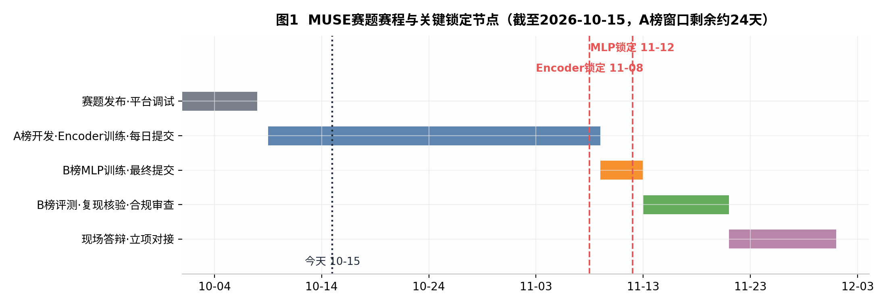
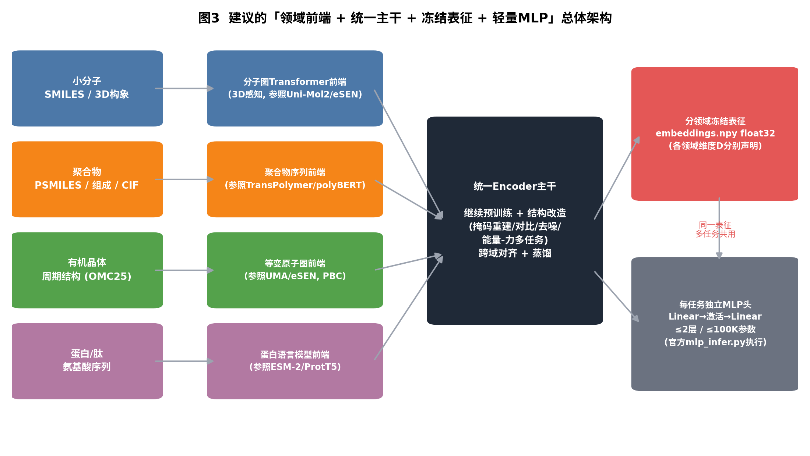
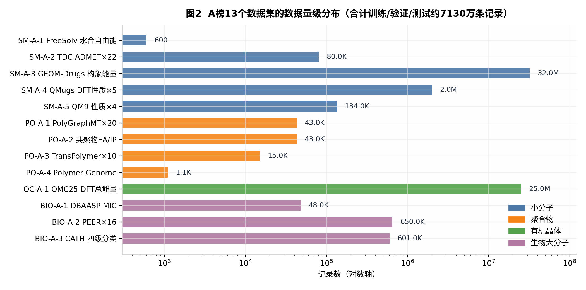
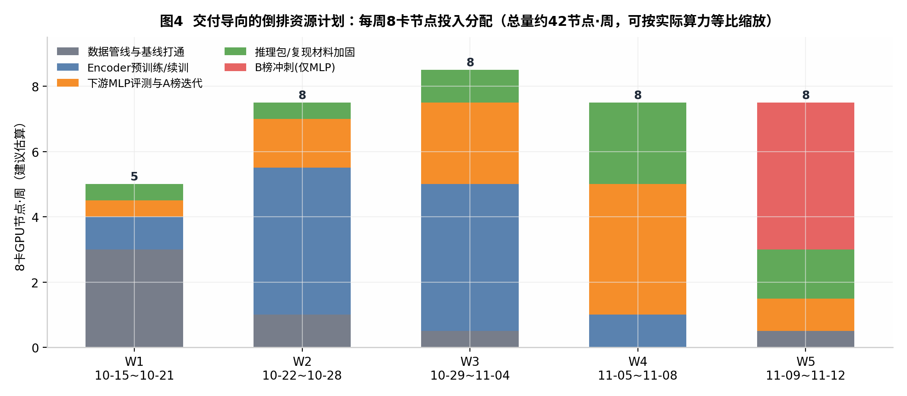

# 面向交付的「跨模态科学数据统一表征」竞赛技术方案研究报告

**研究对象**：新一代人工智能国家科技重大专项 2026 年度"以赛代评"赛事平台赛题一——跨模态科学数据统一表征与多尺度融合（MUSE，OpenCompass 平台）
**撰写基准日**：2026-10-15（A 榜开发窗口内，距 Encoder 锁定约 24 天）

---

## 摘要（TL;DR）

你提出的判断是对的：**这类"预训练统一 Encoder + 冻结表征 + 轻量探针下游评测 + 强制复现审查"的竞赛范式在国际上已相当成熟**（Open Catalyst Challenge、OGB-LSC、BELKA、Open Polymer Challenge 等），其获胜方法论可以直接迁移。以交付为目标，技术方案的设立应遵循五条主线：**（1）架构上**采用"领域前端 + 统一主干 + 分领域表征维度"的形态——赛规只禁止按数据集/子集/记录分支，而表征维度本来就按领域声明，这为模块化设计留下了合法空间；**（2）起点上**以开源原子/分子/蛋白基础模型（UMA/eSEN、Uni-Mol2、ESM-2、polyBERT 谱系）为底座做继续预训练与结构改造，满足"禁止使用未经改变的开源 Encoder"的硬性条款，同时对 UMA 这类训练数据与赛题 OMC25 重叠的模型做严格的数据泄漏隔离；**（3）数据上**把官方辅助标签（约 3000 万构象能量、2500 万帧受力/应力、近 400 万分子性质字段）当作预训练的核心资产，而不是只盯着 A 榜标签；**（4）工程上**从第一天就按"推理包 + 训练复现材料"双交付物倒排开发，Docker digest 固定、随机种子固定、checkpoint 可续跑是及格线而非加分项；**（5）节奏上**以 11-08 Encoder 锁定为不可逆里程碑倒排，预留最后一周做复现演练。报告后半部分给出完整的架构图、选型矩阵、风险登记册和逐周资源计划。

---

## 1 赛题本质与交付物拆解

### 1.1 竞赛机制：这是"以赛代评"，不是普通榜单赛

本赛题隶属于**新一代人工智能国家科技重大专项 2026 年度"以赛代评"公开项目**：通过形式审查的项目申报单位参加赛题比赛，**比赛结果直接决定哪些项目能进入答辩评审与立项环节**([上海交通大学科研院](https://keyan.sjtu.edu.cn/ky-tongzhi/20260731/6001.html))。这意味着竞赛成绩不是终点而是门票，且赛后的复现核验、合规审查与现场答辩都计入最终评价——"交付"的定义因此远超"跑出一个高分"，而是"**交出一套主办方能在隔离环境里独立复现、经得起合规审查的完整技术系统**"。

赛程（图 1）对交付节奏有强约束：A 榜开发期 10-09 至 11-08（每队每日最多 1 次提交，当日 18:00 截止）；**11-08 24:00 锁定 Encoder 及训练复现材料**，此后 Encoder 不可再动；11-09 至 11-12 仅允许在冻结表征上训练 B 榜 MLP 头；11-13 至 11-20 主办方运行参赛方推理包完成 B 榜评测并做复现核验；11 月下旬组织入围团队现场答辩。B 榜占总分 100%，A 榜仅为开发期排行，因此**所有 A 榜动作都应视为对 B 榜泛化能力的预演**，而非目标本身。

### 1.2 计分公式的战术含义

赛题的计分链条是"子任务原始指标 → 归一化到 [0,1] → 数据集内等权平均 → 13 个数据集等权平均 → ×100"。归一化方式为：回归任务 `clip(1−MAE/基线MAE)`（基线为输出训练集标签中位数的常数模型），分类任务 `clip(2×AUC−1)`。这一设计有三个直接的战术推论。**第一，数据集等权意味着小数据集与大数据集同权**——FreeSolv 仅 0.6K 训练记录、Polymer Genome 仅 1.1K，但它们在总分中的权重与 32M 记录的 GEOM-Drugs 完全相同，小数据任务的过拟合风险因此直接转化为总分风险，必须用最严格的交叉验证和早停来守。**第二，任何子任务缺预测、格式非法或 MLP 违规都记 0 分且仍计入数据集平均**，一个 22 子任务的 TDC ADMET 数据集里漏掉一个预测文件，代价是约 1/22 个数据集分；这决定了"完整性自检脚本"是交付流水线的第一优先级，优先于任何模型改进。**第三，归一化是相对无信息基线的**，在标签噪声大、基线 MAE 已经很小的任务上（例如部分 ADMET 终点），分数天花板天然偏低，投入产出比应与任务难度画像匹配，避免在天花板低的任务上消耗算力。

### 1.3 两类交付物与硬性约束清单

参赛交付物分为**推理包**（B 榜正式评测用：submission.json、encode.sh 入口、encoder/ 权重代码、heads/ MLP 描述与权重）与**训练复现材料**（复现审查用：环境定义、数据清单、训练代码配置种子、中间 checkpoint、日志）两大部分。主办方的 B 榜执行方式是：在**单节点 8 卡 GPU、无网络、输入只读**的环境中以镜像 digest 固定运行 `bash encode.sh <INPUT_DIR> <OUTPUT_DIR>`，产出每个子集的 `ids.txt` + `embeddings.npy`(float32[N,D])，再由官方 `mlp_infer.py` 与 `score.py` 完成 MLP 推理和计分。下表汇总了贯穿方案设计全过程的硬性约束，任何一条违反都直接导致子任务 0 分或取消资格，因此它们应当被写成**自动化 CI 检查**而非人工记忆。

| 约束类别 | 硬性条款 | 违反后果 | 工程对策 |
| --- | --- | --- | --- |
| Encoder 共享性 | 所有下游任务冻结共享同一 Encoder；同一领域内所有子集用同一套处理，禁止按数据集/子集/记录 id 分支 | 违规判定 | 代码静态检查 + 单样本乱序/拼批一致性测试 |
| Encoder 来源 | 禁止使用未经改变的开源 Encoder（自研发布的除外），须详述训练方法与数据 | 违规判定 | 继续预训练/结构改造并留存完整训练轨迹 |
| 数据合规 | 预训练只允许公开无标签数据或自建无标签数据；有标签数据仅限 A 榜 | 取消资格 | 外部数据清单 JSONL（来源/许可/hash/用途） |
| MLP 规格 | ≤2 个线性层、≤100K 参数、激活限于 relu/gelu/silu/tanh；禁止阈值、校准、检索、LayerNorm、残差等后处理 | 子任务 0 分 | 提交前用官方 mlp_infer.py 全量自测 |
| 表征契约 | embeddings.npy 为 float32[N,D]，顺序与 ids.txt 一致，数值有限（无 NaN/Inf），同领域 D 一致 | 子集全任务 0 分 | 表征写出后自动校验 schema 与有限性 |
| 记录独立性 | 每条记录的表征只依赖该记录输入，不得依赖批次组成或顺序 | 违规判定 | 打乱批次重跑对比表征哈希 |
| 复现性 | reproduce_encoder.sh / reproduce_heads.sh 在无网络干净环境可跑，种子固定，中间 checkpoint 可续跑 | 取消成绩 | 每周做一次"干净环境复现演练" |

值得强调的是"表征维度按领域声明"这一细节：submission.json 中各领域分别声明表征维度 D，同一领域内所有子集维度相同。这事实上允许 Encoder 内部按领域（sample_type）组织专门的前端与输出头——规则禁止的分支粒度是"数据集/子集/记录 id"，而非"领域"。**这是整个架构设计的合法性支点**，第四章的方案即建立在对这一条款的这种解读上（建议同时在 Q&A 渠道向主办方书面确认，留存答复记录）。

---

## 2 同类竞赛谱系：方案设计的可迁移经验

### 2.1 国际同类赛事盘点

"类似竞赛"不仅存在，而且已经形成一条清晰的演进脉络：从单一性质预测（OGB-LSC 的 HOMO-LUMO gap、Open Catalyst 的吸附能）走向多任务、多模态、强调可复现交付的形态。下表汇总了与本赛题最相近的赛事及其对本方案的启示。

| 赛事 | 主办方/年份 | 任务形态 | 规模与赛制 | 对本赛题的启示 |
| --- | --- | --- | --- | --- |
| OGB-LSC（PCQM4Mv2） | KDD Cup 2021 / NeurIPS 2022 | 分子图→量子性质（HOMO-LUMO gap） | 300 万+分子，公开/私有榜 | 大规模分子性质榜的鼻祖；验证集协议与私有榜隔离的做法被 MUSE 继承 ([arXiv:2512.08896](https://arxiv.org/pdf/2512.08896v1)) |
| Open Catalyst Challenge | Meta FAIR / NeurIPS 2021–2023 | 吸附体系弛豫能预测（DFT 替代） | 600 万+训练样本，限定训练数据与可用预训练 checkpoint | 证明"限制数据来源 + 限定预训练权重来源"是可行的赛事设计；其 OC20 数据集正是 UMA 的训练语料之一 ([Open Catalyst Project](https://opencatalystproject.org/challenge.html), [NeurIPS 2022](https://neurips.cc/virtual/2022/competition/50095)) |
| BELKA | NeurIPS 2024 / Leash Bio | 小分子-蛋白结合亲和力（DNA 编码库） | 亿级测量，Kaggle 私有榜 | 大噪声实验数据上的表征学习；与本赛题 BIO-A 线同源问题 ([arXiv:2512.08896](https://arxiv.org/pdf/2512.08896v1)) |
| NeurIPS Open Polymer Prediction 2025 | Notre Dame / Kaggle | 聚合物 SMILES→5 项 MD 性质 | 1.1 万聚合物，约 2240 队、5 万次提交，奖金 $50K | **最贴近的可迁移样本**：冠军方案 = polyBERT 嵌入 + AutoGluon + Uni-Mol 集成 + 严格 5 折 CV；小数据、稀疏标签、分布偏移三大难点的应对范式可直接搬用 ([赛后报告](https://arxiv.org/html/2512.08896v1), [赛事官网](https://open-polymer-challenge.github.io/)) |
| RoboSense 2025 Track2 等"代码审查型"赛事 | 学术会议/企业 | 感知/导航等 | 最终只接受完整代码包，官方 Docker 环境复现审计，造假或不复现即取消资格 | "提交代码包 + Docker 复现审计"的成熟先例；其 disqualification 条款（绕过评测逻辑、伪造结果文件）与 MUSE 的违规条款几乎逐条对应 ([GitHub: robosense2025](https://github.com/robosense2025/track2)) |
| PACE 2025 | IPEC 算法竞赛社区 | 参数化算法求解 | Docker 容器化统一评测 | 容器化评测的经验教训：正式评测前的验证环节抓出了注释行解析、边角用例、数值精度等大量隐性 bug——**自测环境与官方环境的差异是头号工程风险** ([LIPIcs.IPEC.2025.32](https://drops.dagstuhl.de/storage/00lipics/lipics-vol358-ipec2025/html/LIPIcs.IPEC.2025.32/LIPIcs.IPEC.2025.32.html)) |

### 2.2 获胜方案的共性方法论

对 Open Polymer Challenge 赛后报告的拆解尤其有价值，因为它的数据形态（SMILES 输入、小样本、稀疏标签、多来源数据偏移）与本赛题聚合物线高度同构。其前五名方案收敛出的共性是：**精心的问题域数据清洗与增广、指纹/描述符特征工程、梯度提升树等"强而简单"的模型、严格交叉验证**；第一名使用了 polyBERT 嵌入、AutoGluon 与 Uni-Mol 的集成，并在自监督合成标签上做了 BERT 式预训练 ([赛后报告](https://arxiv.org/html/2512.08896v1))。值得注意的是，前十名全部使用 Morgan 指纹，而纯 SMILES 嵌入和图神经网络各只出现一次——这印证了一个反直觉结论：**在冻结表征 + 轻量头的评测协议下，"知识注入"往往比"模型规模"更值钱**。

另一个可迁移经验是分布偏移的处理。Open Polymer Challenge 中 Tg 标签在训练集与榜单测试集之间存在系统性偏移，头部队伍通过分位数回归目标、fold 级回归校准等手段修正，第三名仅凭校准就提升 5.5% 分数 ([赛后报告](https://arxiv.org/html/2512.08896v1))。但请注意：**MUSE 的 MLP 规范明确禁止校准、阈值等一切后处理**（输出变换被固定为回归 affine / 二分类 sigmoid / 多分类 softmax），因此"校准"这条腿在 MUSE 里必须前移到 Encoder 训练阶段——通过预训练数据配比与标签分布匹配来内化，而不是在推理时外挂。这正是"读懂规则再设计方案"的典型例子：同一战术意图，在不同规则下的合法实现位置完全不同。

---

## 3 技术现状盘点：统一科学表征的可行路径

### 3.1 四条领域线的最强表征模型（Encoder 前端候选）

赛题的 13 个数据集跨越四个领域，每条领域线都已有经过大规模验证的表征模型谱系。方案设计的第一步不是从零造轮子，而是为每条线选定一个"可改造、可声明、可复现"的起点。

| 领域线 | 代表模型 | 关键事实 | 作为前端的适配要点 |
| --- | --- | --- | --- |
| 小分子（SMILES/3D） | Uni-Mol / Uni-Mol2 | Uni-Mol2 最大 1.1B 参数、在 8 亿分子构象上预训练，采用 SE(3) 等变注意力，联合掩码原子重建、距离/角度预测与构象-SMILES 对比目标 ([DeepModeling](https://blogs.deepmodeling.com/Uni-Mol2_18_12_2024/), [arXiv:2508.06199](https://arxiv.org/html/2508.06199v2)) | 3D 构象输入线（GEOM-Drugs/QMugs/QM9）的首选形态；纯 SMILES 任务可退化到 2D 图分支 |
| 小分子（统一原子系） | Meta UMA（eSEN 骨干 + MoLE） | 训练聚合 OMat24/OMol25/OC20/ODAC25/OMC25 五大数据集约 5 亿结构，UMA-S 约 150M 总参数/6M 激活，许可允许商用；代码模型数据均公开 ([arXiv:2506.23971](https://arxiv.org/pdf/2506.23971), [UMA 资料页](https://aiwiki.ai/wiki/uma_meta)) | **最强起点但有最高合规风险**：其训练数据含 OMC25 全集，与赛题 OC-A-1 同源，须做泄漏审计（见 4.2） |
| 聚合物 | TransPolymer / polyBERT | TransPolymer 以 RoBERTa 在约 500 万增广聚合物序列上 MLM 预训练，在 10 个下游性质基准达 SOTA；polyBERT 在约 1 亿假想 PSMILES 上预训练 ([arXiv:2209.01307](https://arxiv.org/html/2209.01307v4), [arXiv:2608.01431](https://arxiv.org/pdf/2608.01431)) | PSMILES/CSMILES 序列前端；共聚物任务需编码"单体+组成"对，注意 TransPolymer 数据集与赛题 PO-A-3 同名同源，预训练语料须去重 |
| 有机晶体 | UMA-OMC / EquiformerV2 / eSEN | OMC25 官方基准显示：联合多数据集训练的 UMA 全面超过仅在 OMC25 上训练的 eSEN-S-OMC，跨数据集互补信息对分子晶体任务显著有益 ([arXiv:2508.02651](https://arxiv.org/html/2508.02651v1)) | 周期性边界条件（PBC）图构建是必备能力；长程相互作用是已知短板，可增大截断半径补偿 |
| 蛋白/肽 | ESM-2 / ProtT5 / ESM-3 | ESM-2 冻结嵌入 + 线性探针在 PFMBench 多数任务上可用；在 MIC 回归这类低数据任务上，ESM-2 预训练表征迁移良好（75 个菌种靶点平均测试 R²≈0.57） ([PFMBench](https://arxiv.org/html/2506.14796v1), [ESM2AMP](https://jouc.xml-journal.net/en/article/pdf/preview/10.1007/s11802-026-6240-9.pdf)) | BIO 线直接以 PLM 为前端；逐残基任务需要输出 tokens.npy，选型时须确认表征的残基粒度可取 |

### 3.2 跨域统一的三条技术路线

"一个 Encoder 理解所有科学模态"在文献中有三条已被验证的路线，本赛题的方案应在其交集中取舍。**路线一：多任务监督预训练（JMP 谱系）**。Meta FAIR 的 JMP 把多个能量/力数据库的每个标签视为独立任务同时训练，在分子、晶体、MOF 等 40 个下游任务中的 34 个达到 SOTA，证明了"能量/力预训练 → 通用表征"的有效性 ([arXiv:2310.16802](https://arxiv.org/pdf/2310.16802v1.pdf))；后续分析表明 JMP-L 的后期交互块收益递减，剪去两块仅损失极小性能、推理提速 1.3 倍——这对受推理时限约束的赛事是直接可用的压缩经验 ([arXiv:2504.19538](https://arxiv.org/html/2504.19538v1))。**路线二：大原子模型多任务学习（DPA-2/UMA 谱系）**。DPA-2 用统一描述符 + 多任务头同时吸收不同 DFT 设置的数据，显著降低下游微调的数据需求 ([npj Comput. Mater.](https://arxiv.org/html/2312.15492v2))；UMA 进一步用按"电荷/自旋/DFT 任务"条件的混合线性专家（MoLE）实现单一权重覆盖多化学域。**路线三：序列化统一（NatureLM/UniGenX 谱系）**。微软 NatureLM 把小分子 SMILES、蛋白序列、材料表示统一为 token 序列，在 1430 亿 token 上预训练出跨域通用模型 ([arXiv:2502.07527](https://arxiv.org/pdf/2502.07527v2))；UniGenX 用"符号 token + 数值 token 混合流"在蛋白、分子、材料上联合训练 ([arXiv:2503.06687](https://arxiv.org/html/2503.06687v2))。

对本赛题的取舍建议是：**以路线一/二（原子级多任务预训练）为主线**，因为赛题数据的大头（GEOM 32M、OMC25 25M、QMugs 2M）全是原子结构数据，且辅助标签直接提供能量/力/应力等 JMP 式预训练所需的监督信号；**以路线三的"领域 token/条件嵌入"思想为胶水**，用领域条件向量把四条前端粘进一个主干，而不是追求单一 tokenizer 统一所有模态——在 24 天的剩余窗口内，后者的工程风险不可控。

### 3.3 冻结表征范式的风险证据（必须正面回应）

赛题的核心协议——冻结 Encoder + 每层任务只允许 ≤100K 参数的 MLP 探针——在文献中恰好是被严格检验过且结论并不乐观的场景。一项覆盖 25 个预训练嵌入模型、25 个基准数据集的系统性评测发现：**几乎所有神经嵌入模型相对简单的指纹模型（ECFP+随机森林）都没有显著改进**，仅知识注入型的 CLAMP 显著更优；MolFormer-XL 与 ChemBERTa-2 作为冻结嵌入使用时在筛选任务上低于 ECFP 基线 ([arXiv:2609.37550](https://arxiv.org/pdf/2609.37550))。CheMeleon（以预测经典描述符为预训练目标）和 Mol-JEPA（融合描述符、实验测量与其他模型嵌入）是少数稳定胜过指纹基线的模型，它们的共同点是**把化学信息学先验显式注入表征** ([arXiv:2609.37550](https://arxiv.org/pdf/2609.37550))。

这组证据对方案的含义是双重的。一方面，它反驳了"拿一个大模型提嵌入就万事大吉"的天真路线——冻结表征的竞争力来自预训练目标与下游性质的**信息对齐**，而非参数规模。另一方面，它指出了一个被多数参赛者可能忽略的机会：既然表征可以原样包含任何 Encoder 内部计算的特征，**把描述符/指纹式的知识注入设计进 Encoder 内部**（例如让 Encoder 的一支显式学习预测 RDKit 描述符、Gasteiger 电荷、元素组成等，CheMeleon 路线），是让 100K 参数的 MLP 探针发挥上限的最便宜手段。蛋白侧的证据同样支持谨慎乐观：AlphaFold2 结构表征相对 ESM-2 的"信息红利"仅在别构等少数任务显著为正，结合亲和力等任务上 ESM-2 序列嵌入反而更强 ([arXiv:2606.04228](https://arxiv.org/html/2606.04228))——这为"蛋白线不引入结构预测模块、纯序列前端"的简化决策提供了依据。

---

## 4 技术方案设计（核心章节）

### 4.1 总体架构：领域前端 + 统一主干 + 分领域表征

建议架构如图 3：四条**领域前端**分别把原始输入编码为领域 token 序列（分子 3D 图 Transformer、聚合物序列编码器、PBC 等变原子图网络、蛋白 PLM），汇入一个**共享主干**（ Transformer 主干 + 领域条件嵌入，参照 UMA 的任务条件 MoLE 思路做轻量专家分支），最后按领域输出维度 D 的冻结表征。这一形态同时满足四项赛规：提交物是"一个统一 Encoder"（单一权重文件、单一加载入口）；同一领域内处理完全一致（前端按 sample_type 路由，sample_type 是记录自身的合法属性，而非数据集名或 id）；表征维度按领域声明；B 榜"每个任务的输入形式都在 A 榜同领域出现过"的保证意味着前端集合在 A 榜阶段即可封板。

表征读出设计上，建议采用"多层加权读出 + 描述符注入"双策略：不以最后一层隐状态为唯一表征，而是在 Encoder 内部学习各层的标量权重做加和（所有权重属于 Encoder 本体，冻结后即为固定表征的一部分，不违反 MLP 规范）；同时让主干的一个专家分支以预测化学描述符/物理量为辅助目标（CheMeleon 思路），使表征空间天然携带可线性读出的性质信息。读出维度建议每领域 512–1024：MLP 参数上限 100K 约束了第一层 Linear 的输入维度（1024 维输入 + 64 隐层约耗 7 万参数），维度再大就会压缩隐层容量，边际收益递减。

### 4.2 Encoder 起点选型与合规化改造

赛规"禁止使用未经改变的开源 Encoder"的合规实现有三条路径，按投入产出排序。**路径 A（推荐主线）：开源权重继续预训练 + 结构改造**。例如以 eSEN/UMA-S 规模的原子图网络为起点，在赛题数据与公开无标签数据上做掩码几何重建、去噪坐标、能量/力多任务继续训练，同时修改结构（增加领域条件嵌入、调整读出层）——"改变"既是实质性的（权重大幅更新、架构可辨识地不同），又可完整声明。**路径 B：蒸馏拼装**。用多个开源教师（Uni-Mol2、UMA、ESM-2、polyBERT）在公开无标签数据上蒸馏进自研学生主干，学生从随机初始化训练，天然满足"非未经改变"，且训练轨迹完全自有；代价是蒸馏本身吃算力。**路径 C：从零预训练**。最干净但在剩余窗口内只对中小模型可行，建议作为兜底对照组而非主线。

**数据泄漏审计是选型的前置闸门**。最典型的风险是 UMA：其训练数据明确包含 OMC25 全集，而 OC-A-1 正是 OMC25 的 25M 结构子集——直接以 UMA 权重为起点，等于让 Encoder 在训练中见过 B 榜同源分布甚至 A 榜测试分子的能量标签，落入"使用任务微调数据未完整声明/测试集等价标签"的审查打击面 ([arXiv:2506.23971](https://arxiv.org/pdf/2506.23971), [赛题 PDF])。合规做法二选一：弃用 UMA 权重、仅复用 eSEN 架构从零/半从零训练；或选用训练语料与赛题四领域无标签重叠的起点，并在 method.md 中逐数据集声明重叠分析（对 SMILES/序列/结构做指纹级去重比对，留存比对脚本与结果）。同理，TransPolymer 的预训练语料（PI1M）与 PO-A-3 的 TransPolymer 数据集、ESM-2 的 UniRef 与 CATH/PEER 序列均需做同样的重叠声明——**审查重点条款"外部数据和任务微调数据是否完整声明"决定了这些审计材料本身就是交付物的一部分**。

### 4.3 预训练数据与目标函数设计

数据侧的决策应围绕一个事实展开：**官方辅助标签是合法的"第二训练集"**——QMugs 其余 37 个 GFN2/DFT 字段（191 万构象）、GEOM 构象与分子级能量（3231 万）、QM9 其余 8 性质、OMC25 逐原子受力与应力（2511 万帧）、PubChemQC（397 万分子）、PCQM4Mv2（345 万）、MegaScale（261 万序列）等，且明确"可选择用于训练 Encoder"。这意味着预训练可以做成 JMP 式的大规模多任务监督训练，而不只是自监督。建议的数据配比与目标函数如下表。

| 预训练目标 | 数据来源 | 作用 | 优先级 |
| --- | --- | --- | --- |
| 能量/力/应力多任务回归 | OMC25 受力应力（2511 万帧）、GEOM 能量（3231 万构象）、QMugs/QM9 辅助字段 | 原子级表征的物理锚点（JMP/UMA 路线核心） | P0 |
| 掩码重建（原子/残基/token） | 全部 A 榜输入（无标签部分）+ 公开无标签库 | 全领域通用的基础自监督 | P0 |
| 3D 去噪/构象-序列对比 | GEOM/QMugs/QM9 构象 | 2D↔3D 模态对齐，SM-A-3/4/5 直接受益 | P1 |
| 描述符预测（知识注入） | 由输入自行计算的 RDKit/Mordred 描述符、Gasteiger 电荷等 | 把可线性读出的化学信息写入表征（CheMeleon 路线） | P1 |
| 序列 MLM 续训 | MegaScale 261 万序列 + UniRef 公开序列 | BIO 线前端适配肽/蛋白分布 | P1 |
| A 榜标签多任务（轻权重） | A 榜 90 个子任务训练集标签 | 合法但被禁止"针对单任务微调主体"——只能作为多任务之一低权重混入 | P2（谨慎，防止过拟合 A 榜分布） |

两点警示。**其一**，A 榜标签混入预训练要极度克制：B 榜考察的是"冻结表征在未见性质上的效果"，预训练过度拟合 A 榜的 90 个性质会侵蚀表征的开放泛化，而这正是评分对象；建议 A 榜标签仅以很小权重作为多任务之一，并配合按性质类型留出的内部泛化验证集来监控。**其二**，数据管线本身要吃掉相当比例的预算：7130 万条记录（图 2）中 GEOM 与 OMC25 占绝对大头，JSONL+外部结构文件（115 GB）的解析、图构建、缓存应在一周内完成并冻结格式，否则后续每次实验都在为管线还债。

### 4.4 MLP 头工程：把 100K 参数用到极限

MLP 规范（Linear→[激活]→Linear、≤100K 参数、无代码、官方 mlp_infer.py 执行）把下游适配压缩成一个纯数值优化问题，工程要点如下。**参数预算分配**：以 D=1024 为例，隐层 48 时两层总参数约 1024×48+48×48+输出层 ≈ 5.2 万，留出余量给 affine 变换折叠；回归任务的输出 affine（logit×scale+mean）应通过训练集统计量精确设定而非让探针自己学，因为官方明确允许其折进最后一层。**种子融合**：规则明确允许"多个种子的 MLP 取平均合并为一个更宽的两层 MLP"——这等于官方许可的免费集成，应对每个任务训练 8–16 个种子的探针，按验证集表现筛选后合并提交。**训练协议**：全部 90+B 榜子任务的探针训练应完全脚本化（统一早停、统一验证协议、统一 safetensors 命名 0.weight/0.bias/2.weight/2.bias），人工逐任务调参在 4 天的 B 榜窗口内不可行；A 榜阶段的 MLP 流水线必须与 B 榜完全一致，唯一的区别是数据源。

一个容易被忽视的细节是**表征与任务的配对验证**：MLP 训练所用的训练/验证表征必须由最终提交的同一推理包生成（赛规明确要求），因此任何 Encoder 的微小改动都会使已训好的全部探针作废。工程上应把"encode → 校验 → 批量训探针 → 计分"做成一键流水线，并把每次 Encoder 版本对应的表征缓存与探针分数入库，形成可追溯的实验台账——这份台账同时也是复现材料中"结果复核"部分的素材。

### 4.5 推理包工程：按官方执行方式反向设计

推理包的正确性标准不是"能跑"，而是"**在主办方的隔离条件下逐字节复现你的本地结果**"。围绕 `bash encode.sh <INPUT_DIR> <OUTPUT_DIR>` 这一唯一入口，建议执行以下工程纪律：镜像以 digest 固定并在 submission.json 声明，镜像内锁定全部依赖版本；输入目录只读假设，一切中间产物写入输出目录或 /tmp；逐子集写出 ids.txt + embeddings.npy（float32、有限值、N 与 D 校验、顺序与输入 JSONL 一致），逐残基任务额外写出 tokens.npy；**批次无关性测试**（同一子集按不同 batch size、乱序、单样本分别编码，表征哈希一致）必须进 CI，因为赛规明确"表征只能取决于该记录输入"。性能方面，B 榜评测有另行公布的运行时长上限，单节点 8 卡意味着吞吐设计要以"25M 级晶体结构 + 3200 万级构象的全量编码能在时限内完成"为基准做容量规划：图构建与邻接表缓存、混合精度推理、按原子数分桶动态批处理是三个关键优化点；若主干采用 MoLE 结构，可参照 JMP 压缩经验裁撤收益递减的交互块换取吞吐 ([arXiv:2504.19538](https://arxiv.org/html/2504.19538v1))。

容器化交付的教训在前述赛事中反复出现：RoboSense 2025 的复现审计直接在官方 Docker 环境执行参赛代码并比对榜单分数，绕过评测逻辑或结果不复现即取消资格 ([GitHub: robosense2025](https://github.com/robosense2025/track2))；PACE 2025 的容器化评测则证明，正式评测前的验证环节能抓出输入解析、边角用例、数值精度等大量隐性缺陷 ([LIPIcs.IPEC.2025.32](https://drops.dagstuhl.de/storage/00lipics/lipics-vol358-ipec2025/html/LIPIcs.IPEC.2025.32/LIPIcs.IPEC.2025.32.html))。对应到本项目：**每周至少在"干净环境"（断网、新容器、仅挂载输入）做一次端到端演练**，演练清单包括 encode.sh 全量跑通、mlp_infer.py 自测、score.py 计分、得分文件 sha256 与本地一致。

### 4.6 复现材料：当作产品来交付

复现审查是本赛事与普通榜单赛的本质差异，材料本身应被视为第二交付物来设计。其核心是两条入口脚本：`reproduce_encoder.sh` 从声明起点出发、只读官方数据与声明的外部数据（主办方按 data_manifest.jsonl 预先下载并校验 sha256）、无网络运行、输出与推理包 encoder/ 同构的权重；`reproduce_heads.sh` 只读 B 榜训练/验证集与推理包，训出全部 MLP 并输出各子任务验证分数。支撑材料包括：环境定义（Dockerfile 或镜像 digest + conda/requirements + 系统依赖）、外部数据清单（每条含名称/版本/来源 URL/许可/获取脚本/hash/用途，机器可读 JSONL）、分阶段训练说明（每阶段的数据、目标函数、步数、学习率，写入 method.md）、**可续跑的中间 checkpoint**（用于核对训练轨迹）与固定随机种子。

实践上的关键认知是：**复现≠逐 bit 一致，而是"在合理误差范围内"一致且可解释**。主办方条款写明复现结果与正式提交存在显著差异时队伍需提供技术解释，无法解释才取消资格。因此应在交付中主动附上"复现容差分析"：自己先做 2–3 次全量/抽样复现，记录验证集分数的波动区间与来源（非确定性算子、混合精度、数据加载顺序），把预期的误差范围写进复现实验说明。这与 TDC 排行榜复现研究的教训一致——即便是公开的 leaderboard 成绩，在数据无版本控制时也常出现不可归因的偏差，主动管理可复现性证据是头部团队与一般团队的分水岭 ([bioRxiv 2026](https://www.biorxiv.org/content/10.64898/2026.02.26.708193v1.full-text))。

---

## 5 交付导向的项目计划

### 5.1 倒排里程碑与资源分配

以两个不可逆锁定点（11-08 Encoder、11-12 MLP）为锚倒排，五个工作周的定位各不相同（图 4）。**W1（10-15~10-21）是管线周**：完成数据下载解析、四领域前端的最小可行版本、encode→MLP→score 全链路打通，并在本周内提交一次 A 榜"全零风险保底"提交（哪怕表征来自未训练的前端 + 均值预测器），目的是让提交系统在第一天就被验证——每队每日仅 1 次提交机会，流程 bug 发现得越晚代价越大。**W2–W3（10-22~11-04）是预训练与迭代周**：主干继续预训练/蒸馏的主力算力投入期，每天以当日 18:00 前的最佳状态提交 A 榜，用公开排行做方法筛选；同时启动数据泄漏审计与外部数据清单撰写。**W4（11-05~11-08）是封板周**：冻结 Encoder 候选，完成干净环境复现演练、推理包加固与复现材料定稿，11-08 提交锁定；本周原则上不再引入任何新模型变更。**W5（11-09~11-12）是 B 榜冲刺周**：仅用下发的 B 榜训练/验证集批量训练 MLP 探针（种子融合合并），按官方流程在 B 榜验证集自测后提交；此时 Encoder 已不可动，所有风险都应已被前期流程消化。

图 4 的资源数字是按"单节点 8 卡"为单位的建议估算（总量约 42 节点·周），实际应按团队算力等比缩放，但**结构不变**：预训练集中在 W2–W3，工程加固的占比逐周上升，W4 起工程投入超过模型投入。这个结构背后的逻辑是交付导向的本质——在剩余 24 天里，"让已有能力被主办方成功复现"的边际价值随时间单调上升，而"再试一个新架构"的边际价值单调下降。算力不足时的砍减顺序应为：先砍预训练规模（用小一号的骨干），再砍蒸馏教师数量，**绝不砍**工程演练与复现材料的投入，因为后者对应的是取消资格级别的风险而非分数级别的损失。

### 5.2 风险登记册

| # | 风险 | 等级 | 触发条件 | 缓解措施 | 兜底预案 |
| --- | --- | --- | --- | --- | --- |
| R1 | 开源起点与赛题数据泄漏重叠（UMA↔OMC25、TransPolymer↔PO-A-3 等） | 高 | 起点权重的训练语料含赛题同源数据 | 选型前做指纹级重叠审计；审计脚本与结果入交付物 | 改用零重叠起点或从零预训练的小骨干 |
| R2 | "按领域分支"的规则解读被主办方否定 | 高 | Q&A 答复要求全领域同一处理 | 第一周即书面提问并留存答复 | 退化为单一图 Transformer 主干 + 模态嵌入，前端合并 |
| R3 | 推理包在官方隔离环境跑不通或超时 | 高 | 断网/只读/8 卡/时限任一不满足 | 每周干净环境端到端演练；吞吐基准测试前置 | 提供减配版 encoder 配置（同一权重、更小 batch/块数） |
| R4 | 小数据任务（FreeSolv 0.6K、Polymer Genome 1.1K）MLP 过拟合 | 中 | 验证-测试分数断裂 | 严格嵌套 CV、种子融合、早停 | 保底：对这些任务提交接近常数模型的探针，锁定基线分 |
| R5 | 预测文件缺项/格式错误导致子任务 0 分 | 中 | manifest 与预测文件不一致 | 提交前自动校验 90+ 子任务全覆盖 | 校验脚本内置"缺失即失败"，不允许带病提交 |
| R6 | 表征含 NaN/Inf 或维度漂移 | 中 | 数值溢出、输入异常结构 | 写出层强制有限性检查与裁剪 | 异常记录回退到领域均值表征（Encoder 内部实现） |
| R7 | 复现分数与提交分数差异超限且无法解释 | 高 | 非确定性来源未受控 | 复现容差分析前置；训练全程记录种子与日志 | 答辩材料中预备技术解释与波动区间证据 |
| R8 | A 榜分数诱导过拟合开发集分布 | 中 | A 榜涨、留出泛化集跌 | 内部按"性质类型留出"建影子 B 榜 | 以影子榜为选型依据，A 榜仅作流程验证 |

### 5.3 合规自查清单（提交前必过）

提交前以机器可读形式逐项核对：①Encoder 权重是否由声明流程产出（ reproduce_encoder.sh 在干净环境跑出同构权重）；②外部数据是否全部入册（名称/版本/URL/许可/hash/用途六要素齐全）；③是否存在任何 A 榜以外的有标签数据进入训练（含起点权重隐含的标签，见 R1）；④Encoder 在所有任务中是否逐位一致（对任意两子集的相同输入编码，权重加载哈希一致）；⑤MLP 描述文件与 safetensors 张量名严格匹配、参数量 ≤100K、无违禁算子；⑥表征文件数值有限、维度与 submission.json 声明一致、批次无关性测试通过；⑦B 榜 MLP 训练是否只用了 B 榜训练/验证集 + 冻结表征；⑧全部种子固定且日志留存。这八项对应主办方公布的审查重点逐条映射，建议在仓库中以 `compliance_check.py` 固化，随每次提交自动运行。

---

## 6 结论

"类似的竞赛"确实已经形成一个成熟的范式家族——从 Open Catalyst Challenge 的"限定数据 + 私有榜"，到 Open Polymer Challenge 的"小数据 + 稀疏标签 + 分布偏移"，再到 RoboSense/PACE 式的"Docker 化提交 + 复现审计"，MUSE 赛题是这些范式在"统一科学表征"命题上的集大成者，其规则细节（领域级表征维度声明、种子融合折宽、affine 折叠、批次无关性）几乎都能在先例中找到对应物与应对经验。以交付为目标的方案设立，本质上是把"研究能力"翻译成"可被隔离环境复现的工程系统"：架构上利用领域级分支的合法空间做模块化设计，起点上以继续预训练/蒸馏改造开源基础模型并前置泄漏审计，数据上以官方辅助标签为预训练主力，工程上以两个锁定节点倒排、每周干净环境演练，合规上以八项自查清单对标审查条款。

最后给一个优先级排序作为行动起点：**今天就应该做的三件事**是——把 encode→MLP→score 全链路用最简模型打通并完成一次 A 榜提交（验证流程而非分数）；就"按领域分支是否合规"向主办方书面提问；启动对候选起点模型（尤其 UMA 与 TransPolymer 语料）的重叠审计。模型选型与预训练目标的细节可以并行迭代，但这三件事中的任何一件延迟一周，都会以不可逆的方式压缩后续所有工作的空间。

---

*本报告基于公开文献、赛事官方文档与赛后报告撰写，数据规模、赛程与规则条款以赛题官方页面与主办方最新公告为准；算力与周期估算为规划参考值，需按团队实际条件校准。*